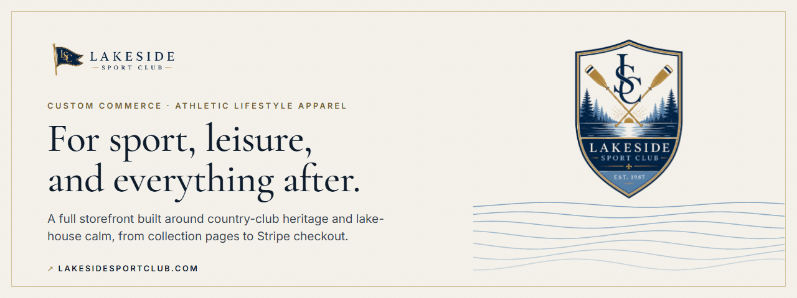
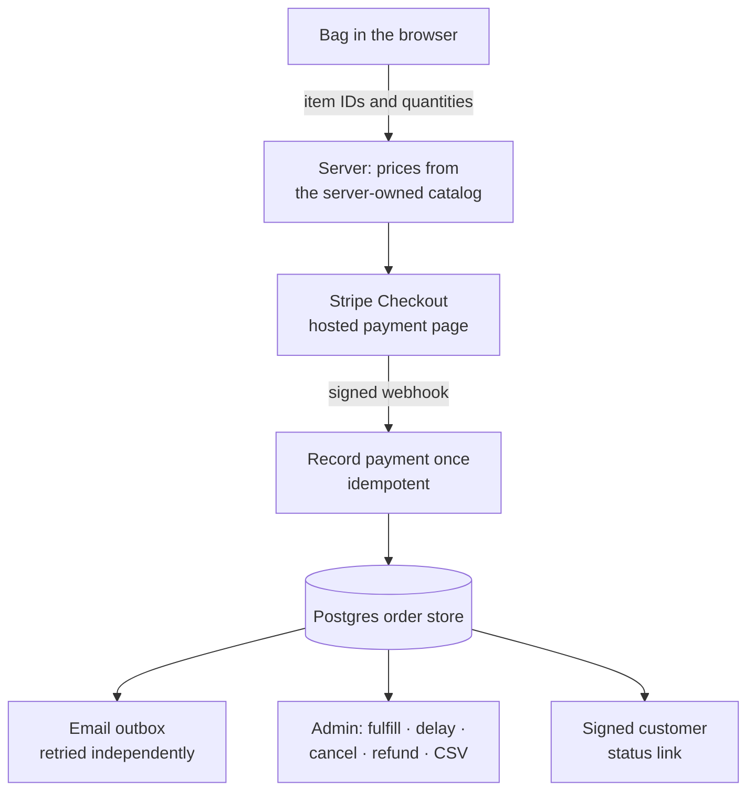

  

<h1 align="center">Lakeside Sport Club</h1>

  <strong>A custom athletic-lifestyle storefront built around country-club heritage and lake-house calm.</strong> 
  <a href="https://lakesidesportclub.com"><strong>Shop Lakeside ↗</strong></a> · <a href="https://www.higginsd.com/work/lakeside-sport-club">Case study</a> · <a href="https://davishiggins.com">Davis Higgins</a>

Live storefront · Client project through Higgins Digital · Designed and built by Davis Higgins

---

## See it in motion

  

Real capture of the live storefront. It stops at the bag, before any checkout or payment step. <a href="assets/demo.png">Static frame</a>

## What it does

- **A brand you can shop.** Large product imagery, collection pages for each drop, and a serif-and-ivory visual language carry the club's identity through every page, not just the homepage.
- **A complete buying path.** Color and size selection, a slide-out bag, an optional shipment-protection add-on, a discount code, and hosted Stripe Checkout, all designed for phones first.
- **Orders that can actually be run.** Paid orders land in a durable order store with signed customer status links, transactional email, and an admin area for fulfillment, delays, cancellations, refunds, and CSV export.

## Why it was built

A new apparel label has to look established before anyone will buy from it. Shoppers decide whether a brand is real in the first few seconds, and a default storefront theme with a logo dropped in says the opposite.

So the brand is built into the shopping experience itself: full-width product visuals, drop-style collection sections for seasonal releases, and a checkout flow designed for the phone, where this audience buys.

## What I built

Lakeside Sport Club is a client project I designed and built end to end through [Higgins Digital](https://www.higginsd.com):

- Brand direction carried through the full storefront: typography, palette, logo usage, and photography treatment
- Product, collection, bag, and content pages, plus size guide, policies, FAQ, and a journal
- The commerce backend: server-owned catalog, Stripe Checkout, webhooks, the order store, and the email outbox
- Admin tools for order operations and the launch checklists the business works from

## How an order moves

### Engineering decisions

| Decision | Why |
|---|---|
| **The server owns the catalog** | The browser sends only product IDs and quantities. Prices, variants, and availability come from the server's catalog when the checkout session is created, so a tampered cart can't change what someone pays. |
| **Card data never touches the site** | Payment happens on Stripe's hosted checkout. The site records Stripe's totals from a verified webhook, including discounts, and the `LSC15` code is checked once for the bag preview and again when checkout is created, so codes can't stack. |
| **Email is an outbox, not a side effect** | Confirmation and status emails are queued and retried on their own schedule, separate from acknowledging Stripe's webhook. A slow email provider can't cause a payment event to be dropped or processed twice. |

Ordering sits behind explicit launch gates for business, tax, email, and provider configuration, so a successful build alone can never open payments. Health and readiness endpoints report status without exposing customer records or connection details.

## Screens

<table>
  <tr>
    <td width="62%"></td>
    <td rowspan="2" width="38%" align="center"></td>
  </tr>
  <tr>
    <td></td>
  </tr>
</table>

Homepage · Shop with category filters · Product page on mobile

## Technology

| Layer | Technology | Responsibility |
|---|---|---|
| Storefront | Next.js (App Router), React, TypeScript, Tailwind CSS | Catalog, product, collection, bag, and content pages |
| Payments | Stripe Checkout, Stripe webhooks, Promotion Codes | Hosted payment, discounts, order confirmation |
| Orders | PostgreSQL on Supabase, zod | Durable orders, events, idempotency keys, outbox |
| Email | Resend | Transactional order email |
| Motion | GSAP, Framer Motion, Lenis | Page transitions and scroll |
| Quality | Vitest, Playwright | Unit and end-to-end tests |
| Hosting | Vercel | Deployment |

## Status

- **Live storefront.** The catalog, bag, and Stripe checkout path are live at lakesidesportclub.com.
- **No invented numbers.** This showcase reports scope, not sales, traffic, or conversion. None have been measured for publication.
- **Demo stops at the bag.** No order was placed and no payment page was opened for this recording.

## About this repository

This is a documentation-only showcase. The storefront's source, configuration, product data, and any customer or order information are private and aren't included here.

**[Shop Lakeside ↗](https://lakesidesportclub.com)** · Built by [Davis Higgins](https://davishiggins.com) · [More of my work](https://github.com/DavisHiggins)

© 2026 Davis Higgins. Screenshots are shared for portfolio viewing. The Lakeside Sport Club name, logos, and product photography belong to Lakeside Sport Club. Stripe is a trademark of Stripe, Inc.
