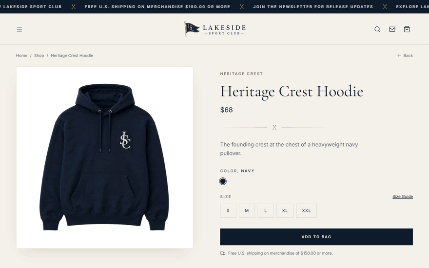
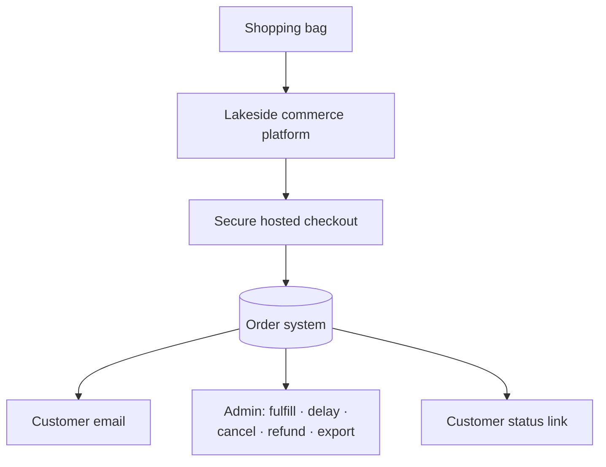
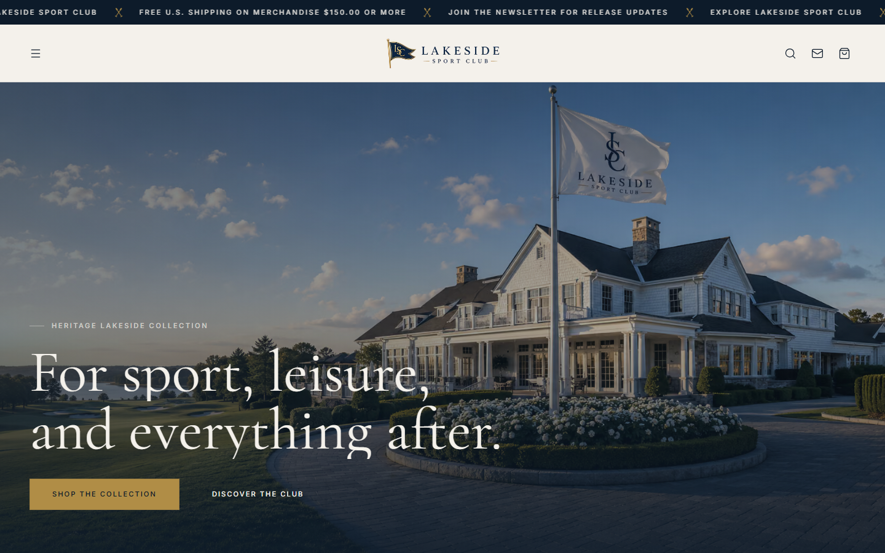
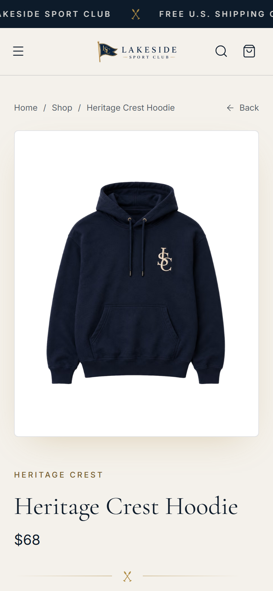
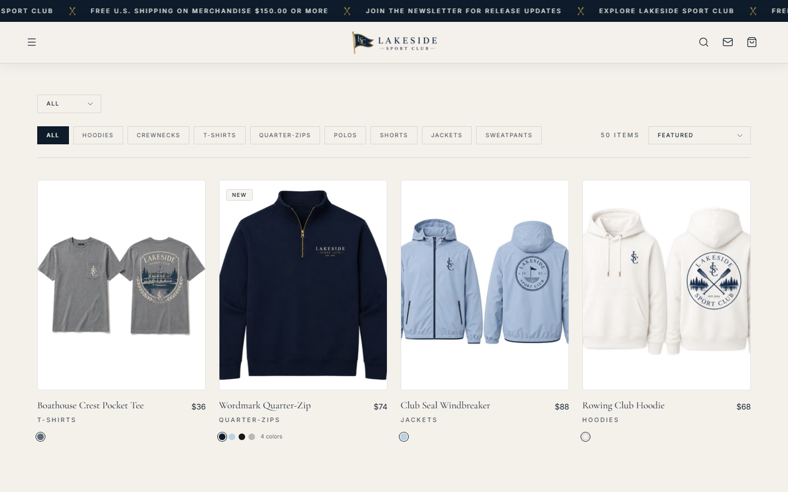

  

<h1 align="center">Lakeside Sport Club</h1>

<strong>A custom athletic-lifestyle storefront built around country-club heritage and lake-house calm.</strong>

  &nbsp;
  &nbsp;
  

Live storefront · Client project through Higgins Digital · Designed and built by Davis Higgins

---

## See it in motion

  

Real capture of the live storefront. <a href="assets/demo.png">Static frame</a>

## What it does

- **A brand you can shop.** Large product imagery, collection pages for each drop, and a serif-and-ivory visual language carry the club's identity through every page, not just the homepage.
- **A complete buying path.** Color and size selection, a slide-out bag, shipment protection, discount codes, and secure checkout, all designed for phones first.
- **Orders that can actually be run.** Every paid order lands in a durable order system with customer status links, transactional email, and an admin area for fulfillment, delays, cancellations, refunds, and exports.

## Why it was built

A new apparel label has to look established before anyone will buy from it. Shoppers decide whether a brand is real in the first few seconds, and a default storefront theme with a logo dropped in says the opposite.

So the brand is built into the shopping experience itself: full-width product visuals, drop-style collections for seasonal releases, and a checkout flow designed for the phone, where this audience buys.

## What I built

Lakeside Sport Club is a client project I designed and built end to end through [Higgins Digital](https://www.higginsd.com):

- Brand direction carried through the whole storefront: typography, palette, logo usage, and photography treatment
- Product, collection, bag, and content pages, plus size guide, policies, FAQ, and a journal
- The commerce platform behind it: catalog, payments, orders, and customer email
- Admin tools for running orders, and the launch checklists the business works from

<strong>How it's put together</strong>

 

| Decision | Why |
|---|---|
| **Prices are never trusted from the browser** | What a shopper pays is always decided by the store, so a tampered cart can't change the total. |
| **Card data never touches the site** | Payment happens on a secure hosted checkout, and the store only records the confirmed result. |
| **Every order is handled exactly once** | Payments, emails, and status updates are designed so a slow service or a retry can never drop or duplicate an order. |

## Screens

<table>
  <tr>
    <td width="62%"></td>
    <td rowspan="2" width="38%" align="center"></td>
  </tr>
  <tr>
    <td></td>
  </tr>
</table>

Homepage · Shop with category filters · Product page on mobile

## Technology

| Layer | Technology |
|---|---|
| Storefront | Next.js, React, TypeScript, Tailwind CSS |
| Payments | Stripe |
| Motion | GSAP, Framer Motion, Lenis |
| Hosting | Vercel |

---

  &nbsp;
  

© 2026 Davis Higgins. The Lakeside Sport Club name, logos, and product photography belong to Lakeside Sport Club.

